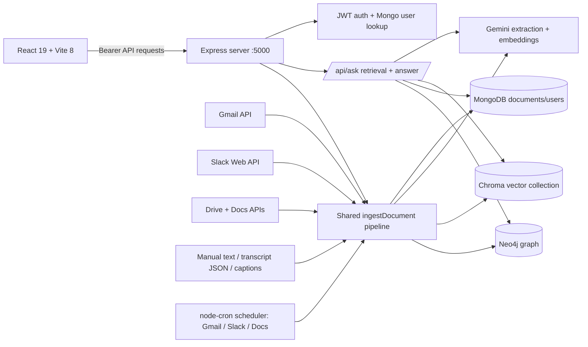

# Trace.AI — verified continuation handoff

**Audit status:** repository reconstruction, first safety/reproducibility repair package, and decision-history feature completed; broader source/security audit remains.
**Last checked:** 2026-10-30.
**Project root:** `D:\SandipUniversitySunhacks2026\Trace.AI`
**Secrets:** `.env` is intentionally not reproduced here. Do not print or commit it.

## Executive status

Trace.AI is an organizational knowledge assistant. It ingests Gmail, Slack, Google Docs, manually pasted text, and transcripts; stores documents in MongoDB; indexes embeddings in ChromaDB; writes relationship data to Neo4j; and answers questions with Gemini using retrieved context and citations. The browser UI is React 19 + Vite 8.

All services (API, Vite, MongoDB, ChromaDB, Neo4j) were **stopped on 2026-10-28** at the user's request and remain stopped as of 2026-10-30. Last known Mongo corpus: **321 documents**; Neo4j node count was **0** before the shutdown. No batch JSON datasets were found under this project root.

The first audit package modified `test_datastore.js`, `services/neo4jService.js`, `server.js`, `routes/ask.js`, and the client manifest/lockfile. The decision-history package (2026-10-30) additionally modified `models/Document.js`, `services/ingestService.js`, `services/aiService.js`, `backfill_graph.js`, `client/src/pages/AskPage.jsx`, `client/src/pages/FeedPage.jsx`, and `client/src/index.css`.

## Decision history (added 2026-10-30)

**Requirement:** when a new decision arrives for a mail or document, the archive must record what the decision changed *from*, in adjacency-list form in Neo4j, and answers must say what the latest decision is and what the previous one was.

**Mongo (source of truth):**
- `models/Document.js` gained `decisionHistory[]` — superseded decisions, oldest first; each entry: `text`, `summary`, `decidedAt` (ISO string), `fromDocId`, `fromTitle`. The current decision stays in `decision`.
- `services/ingestService.js` builds history in two cases before saving: (1) in-place re-sync where the extracted decision differs from the stored one; (2) a follow-up item in the same thread (`metadata.threadId`, Gmail today) reaching a different decision — attributed to the earlier item via `fromDocId`/`fromTitle`. Pure helper `appendSuperseded()` de-duplicates consecutive entries and caps at 20 (`DECISION_HISTORY_MAX`), dropping oldest.

**Neo4j (derived adjacency):**
- `storeDocumentNode(docId, title, source, decision, tags, { history, previousDocId })` now maintains:
  - `(:Document)-[:MADE_DECISION]->(:Decision {text})` — repointed to the current decision only (previously accumulated stale relationships on every update);
  - `(:Document)-[:HAS_DECISION_VERSION]->(:DecisionVersion {docId, version, text, summary, decidedAt, fromDocId, fromTitle, isLatest})` with `(:DecisionVersion)-[:PREVIOUS]->(:DecisionVersion)` — the per-document chain, rebuilt idempotently on each write;
  - `(:Document)-[:PREVIOUS_IN_THREAD]->(:Document)` — mail/slack thread adjacency.
- New read `getDecisionHistory(docId)` returns the chain newest-first.
- `deleteDocumentNode()` removes the document's `DecisionVersion` nodes by `docId` (they are per-document and would otherwise survive as orphans).
- `backfill_graph.js` now passes `history` and computes `previousDocId` per thread, so a graph rebuild reproduces the chains.

**Answering:**
- `services/aiService.js` `buildContext()` emits a `Previous decision: … (superseded <when>) — from earlier item: <title>` line when history exists; `SYSTEM_PROMPT` instructs the model to state the latest decision and name the previous one when relevant; `toCitationPayload()` exposes `previousDecision`, `decisionChangedAt`, `decisionFromTitle`, `decisionVersion`.
- `client/src/pages/AskPage.jsx` shows "Latest / Previously" under each cited source that has history; `client/src/pages/FeedPage.jsx` shows a "Decision changed" block in the expanded card.
- After the user reported that an unscoped question returned “I could not find that in the indexed sources,” `routes/ask.js` gained `isLatestDecisionQuestion()`: explicit “latest/current/most recent decision” queries now choose the newest Mongo document with a real decision by `updatedAt`, then `createdAt`, instead of depending on vector similarity to infer time. It passes that doc and its previous decision into the answer context. New intent regression checks are in `test_smoke.js`.

**Verification (2026-10-30):** smoke **27/27** (6 history-rule + 4 context/citation + latest-decision intent tests), routes **25/25**, chatStore **18/18**, CSS scan **0 missing**, client build passed. Datastores were started, `test_datastore.js` ran **20/20** (including the Neo4j adjacency-chain test and Mongo history round-trip), then `npm run backfill:graph` rebuilt the graph from all **321** original Mongo documents (**0 failures**; before the demo record: 567 nodes, 321 Document, 157 Tag, 42 Decision, 42 DecisionVersion, 5 Source; 42 MADE_DECISION — one per decided document; 2 PREVIOUS_IN_THREAD links). After the latest-question fix, API and frontend health returned HTTP 200. No live Gemini answer was run as a verification step; live calls may consume quota.

**Live proof artifact (intentionally retained):** a clearly synthetic Mongo+Neo4j record titled `Prof Demo - Shipping Policy`, ID `6ae46f030fa495b893e9837e`, was created using the actual `ingestDocument()` production path with mocked extraction and Gemini API key disabled (no external model calls). Three in-place updates demonstrated:
1. `Decision A - ship on Fridays`
2. `Decision B - ship on Wednesdays` (previous A retained)
3. `Decision C - no Friday shipping` (previous B retained; A remains in history)

Direct Mongo read verified `decision = C` and two `decisionHistory` entries `[A, B]`. Direct Neo4j read verified DecisionVersion v1/v2/v3 with `PREVIOUS` links `v3 → v2 → v1`; exactly one `MADE_DECISION` points to C. `buildContext()` for this Mongo document produced the exact model context lines `Decision: Decision C - no Friday shipping` and `Previous decision: Decision B - ship on Wednesdays (superseded 2026-10-30T10:18:44.542Z)`. `toCitationPayload()` returned C as `decision`, B as `previousDecision`, `decisionVersion: 3`. This synthetic record is retained for the user’s professor demo; remove it later by its unique `metadata.googleDocId = PROF-DEMO-1` if desired. It has no Gemini embedding (key was disabled), so it is keyword-searchable only.

**Current service state (2026-10-30):** Full project is running. Mongo `27017`, Chroma `8000`, Neo4j Bolt `7687`/Browser `7474`, API `5000`, and Vite `5173` are listening. `http://localhost:5000/health` and `http://localhost:5173/` both returned HTTP 200 after the API restart. API runs with `DISABLE_CRON=true`, so scheduled Gmail/Slack/Docs polling is disabled for this run (manual sync actions may still contact providers). Neo4j Browser is at `http://localhost:7474`; UI at `http://localhost:5173`.


## Repository / tools

- Branch named in `.git/HEAD`: `WithGemini`.
- `.git` exists, but the Git executable is not installed/on PATH in this environment. A read-only parser confirmed `.env` is **not in the Git index**; `.env.example` is. **Git working-tree status/diff and commit history could not be verified.** The index has 45 entries; many current first-party files (including `test_datastore.js` and `PROJECT_CONTEXT.md`) are not in that index. Preserve them as user work.
- No `AGENTS.md`, README, `PROJECT_HANDOFF.md` (before this file), or `PROJECT_STATUS.md` was present.
- Runtime: Node `v22.20.0`, npm `10.9.3`, PowerShell 5.1. Root and `client/` each have npm manifests and lockfiles. Root dependencies are CommonJS; client package declares ESM.
- Inventory: backend `server.js`, 7 route modules, 2 Mongoose models, 8 service modules, auth middleware, PowerShell/Python datastore launchers, migration/inspection helpers, and backend tests. Client has Vite entry, router/session/API/chat store, 7 React pages, one large CSS design system, and route/chat-store tests. `client/src/main.ts`, `counter.ts`, assets and legacy Vite scaffold appear unused; verify import graph before any deletion.
- Generated/data directories present: `node_modules/`, `chroma_data/`, `chroma_db/`, `chroma_server/`; do not clean/delete them casually.

## Architecture and data flow



Important boundaries:

- Mongo is the primary document/account store. Chroma and Neo4j are derived indexes and are treated as best-effort by ingest.
- `services/ingestService.js` centralizes validation, dedup, extraction, Mongo writes, vector upserts and graph writes.
- `routes/ask.js` retrieves vector matches, keyword fallback, then optional graph expansion; `services/aiService.js` generates grounded answers and citations.
- Google OAuth is shared by Gmail/Drive/Docs in `services/googleAuth.js`. Tokens are expected at `gmail_tokens.json` (currently absent); do not reproduce token contents.
- Workspace data is globally shared by design according to `PROJECT_CONTEXT.md`; chat history is per-account and tab-scoped in session storage.

## Startup / current service state

```powershell
# repo root
npm run db:start
npm start

# separate terminal
cd client
npm run dev
```

Ports: API `5000`; Vite `5173`; Chroma `8000`; Mongo `27017`; Neo4j Bolt `7687`, browser `7474`. Chroma and Vite may bind only on IPv6; probe `localhost` / both loopback families, not IPv4 alone.

Safe stop order: stop API and Vite first, then `npm run db:stop` (uses `scripts/start-datastores.ps1 -Stop`). Do not stop unrelated processes by name alone.

**At audit time:** API `5000` closed; Vite `5173` closed; Chroma `8000`, Mongo `27017`, Neo4j `7687`/`7474` listening. Public `/health` could not be checked because API was down. Google token file absent. Do not start the API casually during audit: its scheduler can call integrations/Gemini.

## Important files

| Path | Responsibility |
|---|---|
| `server.js` | Express middleware/routes, health endpoints, Mongo boot, cron registration, shutdown, request logging |
| `routes/auth.js`, `middleware/auth.js`, `models/User.js` | registration/login/logout, JWT, rate limits, bcrypt, token revocation and role guards |
| `routes/ask.js`, `services/aiService.js` | retrieval, context/citations, Gemini model chain, retry/timeout, embeddings |
| `routes/ingest.js`, `services/ingestService.js`, `models/Document.js` | manual/transcript ingest and common storage/dedup pipeline/schema/indexes |
| `routes/gmail.js`, `routes/gdocs.js`, `routes/slack.js` | source APIs, normalization, sync and scheduler-gated manual endpoints |
| `services/googleAuth.js` | Google OAuth state validation, refresh token persistence, Gmail/Drive/Docs handles |
| `services/chromaService.js`, `services/neo4jService.js` | vector and graph indexes; best-effort errors/status |
| `services/scheduler.js` | cron cadence, single-flight locks, backoff, manual/cron coalescing |
| `services/transcriptParser.js` | JSON / WebVTT / SRT / plain-text normalization |
| `scripts/start-datastores.ps1`, `scripts/chroma_server.py` | Windows datastore lifecycle and Chroma launcher |
| `client/src/App.jsx`, `router.jsx`, `routes.js`, `session.js` | shell, browser routing/auth guards, persisted session and logout |
| `client/src/api.js`, `chatStore.js` | API wrapper and per-account sessionStorage conversation history |
| `client/src/pages/*.jsx`, `client/src/index.css` | landing/login/dashboard/ask/documents/ingest/settings UI and design system |
| `PROJECT_CONTEXT.md` | prior handoff, last verified 2026-10-15; useful but stale and must be checked against current code |

## Configuration / dependencies

Environment variable **names only** (values intentionally omitted):

- Server: `PORT`, `NODE_ENV`, `BODY_LIMIT`, `CORS_ORIGINS`, `MONGO_URI`.
- Auth: `JWT_SECRET`, `JWT_TTL`, `ALLOWED_DOMAINS`, `LOGIN_RATE_WINDOW_MS`, `LOGIN_RATE_MAX`, `LOGIN_IP_RATE_MAX`, `REGISTER_RATE_MAX`.
- AI: `GEMINI_API_KEY`, `GEMINI_MODEL`, `GEMINI_MODEL_FALLBACKS`, `GEMINI_EMBED_MODEL`, `GEMINI_MAX_RETRIES`, `GEMINI_BACKOFF_MS`, `GEMINI_TIMEOUT_MS`, `GEMINI_FALLBACK_TIMEOUT_MS`, `GEMINI_RETRY_BUDGET_MS`, `ASK_GEMINI_TIMEOUT_MS`, `ASK_CONTEXT_CHARS`, `ASK_TOP_K`, `ASK_GRAPH_EXPANSION`.
- Chroma/Neo4j: `CHROMA_URL`, `CHROMA_COLLECTION`, `CHROMA_EMBED_DIM`, `CHROMA_TENANT`, `CHROMA_DATABASE`, `NEO4J_URI`, `NEO4J_USERNAME`, `NEO4J_PASSWORD`.
- Sources/scheduler: Google OAuth variables (`GMAIL_CLIENT_ID`, `GMAIL_CLIENT_SECRET`, `GMAIL_REDIRECT_URI`, `GMAIL_TOKEN_PATH`, `GOOGLE_DRIVE_FOLDER_ID`, `GOOGLE_STATE_TTL_MS`); Slack (`SLACK_BOT_TOKEN`, `SLACK_PAGE_SIZE`, `SLACK_CONCURRENCY`); ingestion limits (`INGEST_MAX_CHARS`, `GMAIL_BODY_CHARS`, `GMAIL_MAX_RESULTS`, `GDOCS_MAX_CHARS`); cron (`CRON_INTERVAL`, `DISABLE_CRON`, `CRON_MAX_BACKOFF_MIN`, `CRON_STAGGER_MS`). Tests also read `TEST_API_BASE`, `TEST_AUTH_EMAIL`, `TEST_AUTH_PASSWORD`, `API_URL`, `SUITE_EMAIL`, `SUITE_PASSWORD`.
- `.env` has no duplicate assignment keys and is not in the Git index. Its secrets must remain private. `.env.example` is unusually large (~118 KB, with very long comment lines); inspect without printing values before deciding whether it needs cleanup.
- Code defaults differ from local config: Chroma default collection/dimension is v1/768, while local `.env` selects v2/3072. Always honor actual deployment config and test collection dimensions.

## Dataset audit

- Recursive first-party search excluding `.git`, dependencies and generated Chroma stores found **no `batch_03.json`, `batch_04.json`, `batch_05.json`, `batch_06.json`, or other batch/dataset JSON files**. Only package manifests/lockfiles and `client/tsconfig.json` are first-party JSON/config files.
- Therefore batch schema, record quality, ID uniqueness, timestamps, encoding, cross-batch gaps/overlaps, and consumer assumptions are **not verifiable from this checkout**. Ask the user to supply/place those source datasets if this audit remains in scope; never synthesize replacements.

## Prioritized findings

### DATA-001 — Test suite could erase the entire live Neo4j graph — mitigated
- **Severity:** High · **Confidence:** Confirmed original defect; mitigation tested against configured local stores.
- **Original evidence:** `test_datastore.js` globally deleted all Neo4j nodes in its connectivity setup and cleanup, then created a few test fixtures.
- **Change:** Connectivity probe is read-only (`RETURN 1`); graph assertions use reserved test-prefixed tag/decision values; cleanup is restricted to fixture document IDs and their now-orphaned prefixed satellites. `services/neo4jService.js:249-272` now only prunes satellites attached to the document being deleted, rather than globally sweeping every orphan.
- **Verification:** `node test_datastore.js` passed **18/18** against the configured Mongo/Chroma/Neo4j services. The graph was already empty before the change; test left it empty. Original cause of empty graph remains unknown.
- **Remaining caution:** `reset.js` intentionally contains a whole-graph delete (`MATCH (n) DETACH DELETE n`); it is explicitly destructive and must not be run without authorization.

### REL-001 — Clean client install removed the TypeScript compiler used by build — fixed, clean install pending
- **Severity:** High · **Confidence:** Confirmed original defect.
- **Evidence:** Build invokes `tsc`; TypeScript existed only in the lockfile/extraneous local install, and offline `npm ci --dry-run` showed it would be removed.
- **Change:** Declared `typescript: ~6.0.2` in `client/package.json` and synchronized the lockfile offline.
- **Verification:** `npm ls --depth=0 --omit=optional` now reports TypeScript normally; `npm run build` passes. A destructive-to-local-`node_modules` `npm ci` was not run because Git status is unavailable.

### SEC-001 — HTTP logger could record OAuth callback authorization code — mitigated
- **Severity:** High · **Confidence:** Confirmed original behavior.
- **Evidence:** OAuth callback receives `code` and `state` query parameters; request logger previously included `req.originalUrl`.
- **Change:** `server.js:58-60` logs `req.path`, which excludes query parameters.
- **Verification:** Static syntax check passed. Focused runtime logger regression test remains desirable; server was not started due integration side effects.

### REL-002 — Ask’s advertised 10-second timeout is not an end-to-end deadline
- **Severity:** High · **Confidence:** Confirmed by call flow.
- **Evidence:** `routes/ask.js:211-228` awaits retrieval (including Gemini embedding) before invoking `answerQuestion`. `services/aiService.js:707-724` runs embeddings through retry logic without a hard per-attempt timeout. `ASK_GEMINI_TIMEOUT_MS` is passed only to text generation; `generateWithFallback()` may still retry/fallback for HTTP 429/5xx, which are not the explicit timeout error.
- **Impact:** `/api/ask` can exceed 10 seconds before generation begins, or spend additional retries/fallback time; the user-facing “too much traffic” timeout is not guaranteed at 10 seconds. Model exhaustion with `UPSTREAM_UNAVAILABLE` still returns HTTP 502 rather than the friendly response.
- **Remediation:** Add a bounded deadline for the complete user-facing ask operation (retrieval + generation) and map upstream saturation/unavailability to a deliberate response. Since the current Gemini SDK cannot cancel an in-flight call, document that a timed-out upstream may continue consuming quota.
- **Verification:** Stub delayed embedding, repeated 429s and delayed fallback; assert the HTTP response returns by the configured deadline with the expected safe UI state and no unhandled rejection.

**Partial change:** `routes/ask.js:254` now also maps exhausted upstream retry/capacity failures (`UPSTREAM_UNAVAILABLE`) to the same friendly response as `UPSTREAM_TIMEOUT`. The end-to-end deadline across embedding/retrieval/generation remains unresolved; do not mark this finding fixed.

### DATA-002 — Derived graph index is currently empty
- **Severity:** Medium · **Confidence:** Confirmed current state.
- **Evidence:** Read-only Neo4j count was 0; Mongo count was 321 (`slack 274`, `gmail 31`, `google_docs 10`, `transcript 6`).
- **Impact:** `routes/ask.js` graph expansion cannot find related documents; primary vector/keyword retrieval remains separate.
- **Remediation:** First fix DATA-001; then obtain approval before running the non-destructive MERGE-based `backfill_graph.js` against live data.
- **Verification:** Count graph documents before/after and compare node IDs against Mongo. Do not run now without user authorization.

### DOC-001 — Local handoff is stale and no dataset handoff exists
- **Severity:** Medium · **Confidence:** Confirmed.
- **Evidence:** `PROJECT_CONTEXT.md` says last verified 2026-10-15; current 2026-10-28 state differs (notably no Google token file, empty Neo4j, API/Vite stopped). Mentioned batch JSON files are absent.
- **Impact:** A new agent could incorrectly treat integrations, graph state, startup, or data inventory as currently healthy.
- **Remediation:** Keep this file current and use runtime checks over inherited claims.

## Baseline actually executed (2026-10-28)

| Check | Result |
|---|---|
| `npm run test:smoke` (root) | 16 passed, 0 failed |
| `node test_transcript.js` (root) | 36 passed, 0 failed |
| `node test_scheduler.js` (root, `$env:CRON_STAGGER_MS='0'`) | 21 passed, 0 failed. Unconstrained first run had 3 timing failures; constrained rerun passed. |
| `node test_routes.js` (client) | 25 passed, 0 failed |
| `node test_chatstore.mjs` (client) | 18 passed, 0 failed |
| `node check_classes.mjs` (client) | 228 used, 240 CSS, 0 missing |
| `npm run build` (client) | TypeScript + Vite build passed; 1734 modules, ~350ms |
| `npm ls --depth=0 --omit=optional` | dependencies resolve locally; client flags TypeScript as extraneous |
| `npm ci --dry-run --ignore-scripts --offline` (client) | dry run says TypeScript will be removed |
| `node test_datastore.js` | 18 passed, 0 failed after replacing global Neo4j deletion with fixture-scoped cleanup. It exercises the configured local Mongo/Chroma/Neo4j stores. |
| `test_auth.js`, `test_transcript_e2e.js` | **NOT RUN** — API was down; tests require live API and some mutate account/docs |
| `test_sync.ps1` / live provider tests | **NOT RUN** — external integrations / rate limits and credentials not revalidated |

Tests that failed or were blocked are not counted as passes. A prior conversation reported broader test results; they are historical only and not a substitute for this baseline.

## Earlier implementation changes to verify / preserve

The current checkout contains the earlier session’s changes; source was inspected for the current state:

- Transcript normalizer supports Zoom/Meet/Teams-shaped JSON, VTT/SRT, and plain text; `routes/ingest.js` stores schema-declared transcript metadata.
- Shared ingest path uses provider dedup queries and Mongo unique indexes; GDocs sync skips unchanged `modifiedTime` and updates documents in place.
- Scheduler uses single-flight locks for cron/manual synchronization and backoff.
- Ask path has cited-source filtering, smalltalk short-circuit, graph expansion, and a 10s generation timeout/friendly timeout response. REL-002 is still open because this is not end-to-end.
- Frontend includes the `FeedPage.jsx` text-selection guard: card click ignores non-empty `window.getSelection()`, intended to stop a selected reasoning/source text drag from closing the card. Automated class scan/build pass; manual browser selection/copy behavior has not been verified in this audit.
- UI stylesheet removed shell-level blur filters according to recent history; build passes. Frame rate has not been measured on a real browser/device in this audit.

## Current blockers / unknowns

- Git CLI unavailable: cannot obtain a trustworthy working-tree diff, full branch history, or changed-file list. Do not overwrite files based on assumptions.
- No supplied batch data: no batch schema/duplicate/reference audit possible.
- API/Vite stopped; no live API contract/auth/E2E checks executed.
- Google token JSON absent; OAuth connection status cannot be confirmed without starting API/reauthorizing.
- Gemini quota/capacity is known from prior notes to have caused 429/503, but was not probed here; do not make billable calls without asking.
- Neo4j is empty; don't rebuild without permission.
- No dependency vulnerability audit was run; npm audit would require external registry access.

## Next actions, in order

1. Complete an end-to-end `/api/ask` deadline across embedding, retrieval and answer generation; stub upstream calls and avoid Gemini billing.
2. Add focused automated regression checks for path-only HTTP logging and ensure query values are not logged.
3. Ask for authorization before MERGE-based Neo4j backfill. Graph currently has zero nodes against 321 Mongo documents.
4. Recheck the FeedPage select/copy bug manually in a browser once API/UI are started; avoid enabling cron/provider calls unless needed.
5. Continue source-by-source review and update this handoff after each work package. Re-run live/auth/E2E tests only with appropriate service/user approval and avoid expensive provider calls.

## Safe resumption instructions

1. Start by checking `Get-Location`, file timestamps, `.git/HEAD`, whether Git is available, and all six service ports. Do not assume the previous process state.
2. Read this file and `PROJECT_CONTEXT.md`; treat runtime state and source as authoritative over stale notes.
3. The datastore suite is now fixture-scoped, but review the current source before running after future changes. Never run `reset.js`; it deletes the graph.
4. Never run `reset.js`, `purge_slack.js`, a graph rebuild, or any cleanup command without checking scope and authorization.
5. Keep `.env`, OAuth token files, provider credentials and user data out of tool output/handoff text.
